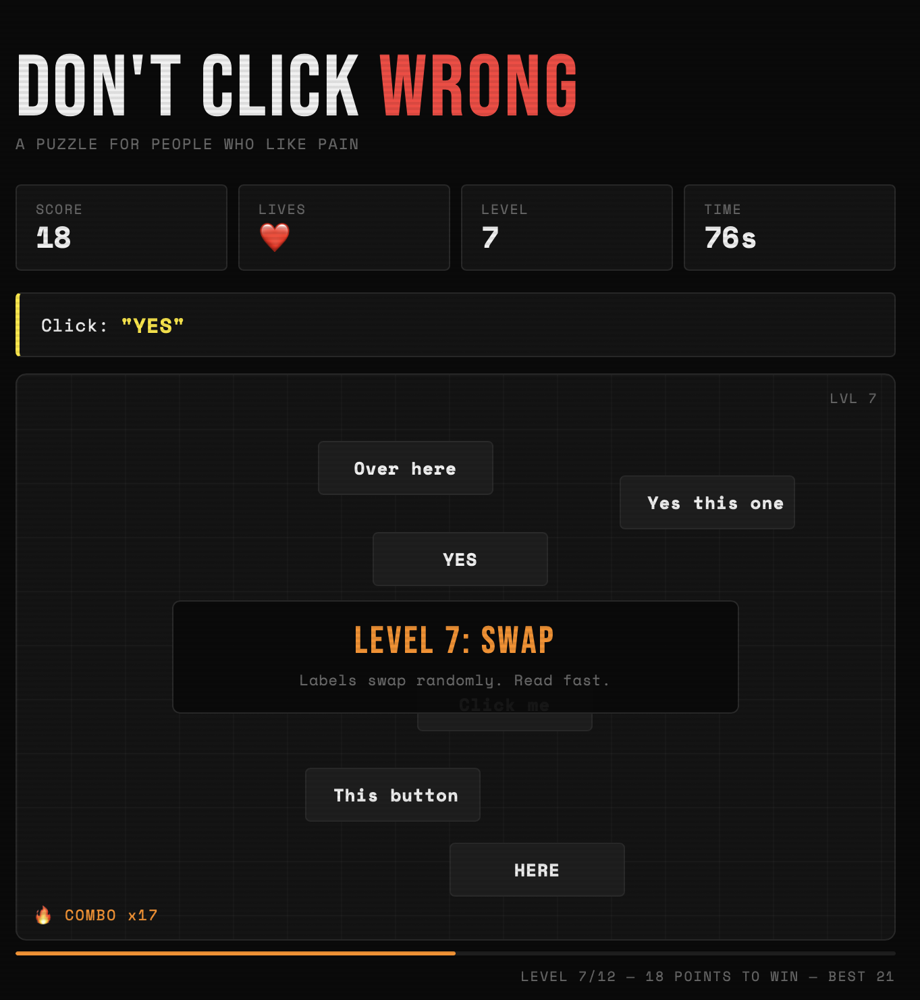

# 🎮 DON'T CLICK WRONG

> A chaotic browser game where one wrong click can ruin everything.

<p align="center">
  
</p>

<p align="center">
  <a href="https://word-ragebait.vercel.app/">
    
  </a>
  <a href="https://github.com/Rishabjainwork/word-ragebait">
    
  </a>
</p>

---

## 🧠 About

**DON'T CLICK WRONG** is a fast-paced browser game built around one simple rule:

> **Click the correct button. Do not click wrong.**

What starts as a simple reaction game quickly becomes chaotic.

Buttons move.  
Labels lie.  
Targets shrink.  
Instructions flicker.  
The screen shakes.

And eventually, you face the **Final Boss**.

The game combines progressively difficult levels, visual effects, sound feedback, combo mechanics and deliberately frustrating "ragebait" moments into a lightweight browser experience.

---

## 🎮 Play

### 👉 [Play DON'T CLICK WRONG](https://word-ragebait.vercel.app/)

No installation required.

Try to survive all **12 levels** and reach **36 points**.

---

## ✨ Features

### 🎯 Gameplay

- 12 progressively harder levels
- 36-point victory condition
- 3 starting lives
- Final boss with a single life
- Moving targets
- Shrinking buttons
- Fake button labels
- Blinking targets
- Flickering instructions
- Random chaos events

### ⚡ Visual & Audio Effects

- Screen shake
- Particle explosions
- Button bounce animations
- Button glow effects
- Flash effects
- Pop animations
- Dynamic background tension
- Sound effects
- Background music
- Wrong-click taunts
- Game-over messages

### 🔥 Combo System

Consecutive correct clicks unlock special rewards.

| Combo | Reward |
|:---:|---|
| **x5** | Bonus visual burst |
| **x8** | Temporary slow motion |
| **x10** | Brief button freeze |

### 📱 Browser Features

- Responsive desktop and mobile layout
- Mobile vibration feedback
- Persistent best score
- `localStorage` score saving
- Preloaded audio pools
- Browser-based audio handling

---

## 🛠️ Tech Stack

<p align="center">
  
  
  
</p>

| Technology | Purpose |
|---|---|
| **HTML5** | Structure and game interface |
| **CSS3** | Layout, animations, effects and responsive design |
| **Vanilla JavaScript** | Game logic, levels, timers and interactions |
| **Audio API** | Music and sound effects |
| **localStorage** | Persistent best score |
| **Vibration API** | Mobile feedback |

No frameworks.  
No game engine.  
No build system.  
No external dependencies.

---

## 🧩 How It Works

The core game loop is simple:

```text
Instruction
     ↓
Generate Targets
     ↓
Player Clicks
     ↓
Is It Correct?
   ↙       ↘
 YES       NO
  ↓         ↓
Score     Lose Life
  ↓         ↓
Combo     Taunt
  ↓
Increase Difficulty
     ↓
Next Level
```

Each level introduces additional difficulty and interaction mechanics, making it progressively harder to identify and click the correct target.

---

## 🏗️ Project Structure

```text
word-ragebait/
│
├── index.html
├── play.html
├── script.js
├── style.css
├── config.js
│
├── screenshot.png
├── logo.png
├── favicon.png
│
├── robots.txt
├── sitemap.xml
├── Ads.txt
│
├── sound/
│   ├── correct.mp3
│   ├── combo.mp3
│   ├── levelup.mp3
│   ├── gameover.mp3
│   ├── wrong.mp3
│   └── music.mp3
│
└── readme.md
```

---

## 🚀 Run Locally

Clone the repository:

```bash
git clone https://github.com/Rishabjainwork/word-ragebait.git
```

Enter the project directory:

```bash
cd word-ragebait
```

### Option 1 — Open directly

Open `index.html` in your browser.

### Option 2 — Use a local server

```bash
python3 -m http.server 8000
```

Then visit:

```text
http://localhost:8000
```

---

## 🎮 Controls

| Action | Control |
|---|---|
| Click target | Mouse / Touch |
| Start game | `Enter` / `Space` |
| Restart game | `Enter` / `Space` |

The game is designed to work on both desktop and mobile devices.

---

## ⚙️ Customization

Most gameplay configuration is handled inside `script.js`.

Important configuration values include:

```text
GOAL
MAX_LEVEL
BUTTON_W
BUTTON_H
LEVEL_DEFS
labels
taunts
deathTaunts
```

You can modify:

- Victory score
- Number of levels
- Button dimensions
- Level difficulty
- Button labels
- Wrong-click messages
- Game-over messages

Visual styling and animations are handled inside `style.css`.

Audio assets are stored inside:

```text
sound/
```

You can replace the audio files while keeping their filenames.

---

## 🔊 Browser APIs

The game makes use of browser capabilities including:

- `Audio`
- `localStorage`
- `navigator.vibrate()`
- CSS animations

Some browsers block audio until the user interacts with the page. Starting the game provides the required user interaction to enable audio.

---

## 🧪 Development

Check JavaScript syntax with:

```bash
node --check script.js
```

No package installation is required.

---

## 💡 What I Learned

Building this project provided hands-on experience with:

- Game-state management
- Timers and event handling
- Progressive difficulty
- DOM manipulation
- Browser APIs
- Animation systems
- Audio feedback
- Responsive web design
- Persistent client-side state
- Designing interactive user experiences

The project intentionally uses vanilla web technologies to understand how much can be built directly in the browser without relying on frameworks or game engines.

---

## 📸 Preview

<p align="center">
  
</p>

---

## 👨‍💻 Author

**Rishab Jain**

<a href="https://github.com/Rishabjainwork">GitHub</a>

---

<p align="center">
  <strong>Click carefully. 😈</strong>
</p>
